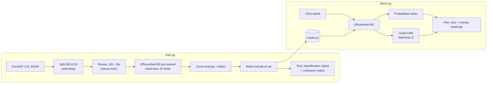

# Arsitektur

| File | Peran |
|---|---|
| `src/dataset_loader.py` | unduh EuroSAT, split, transform |
| `src/classifier.py` | model, training loop, evaluasi, Grad-CAM |
| `train.py` | latih dan laporan metrik |
| `demo.py` | prediksi dan visualisasi Grad-CAM |
